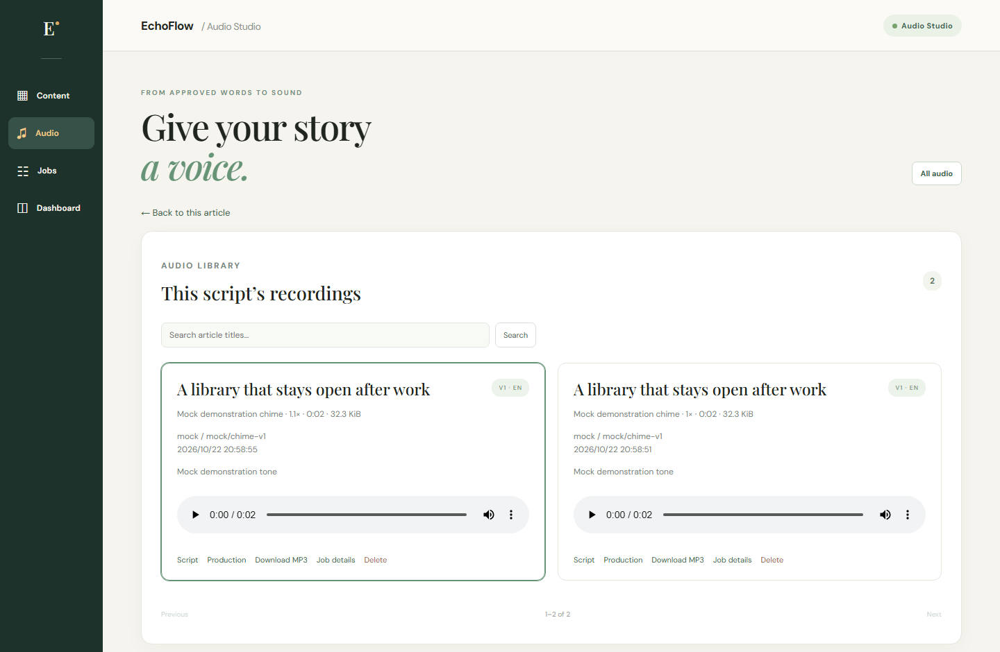
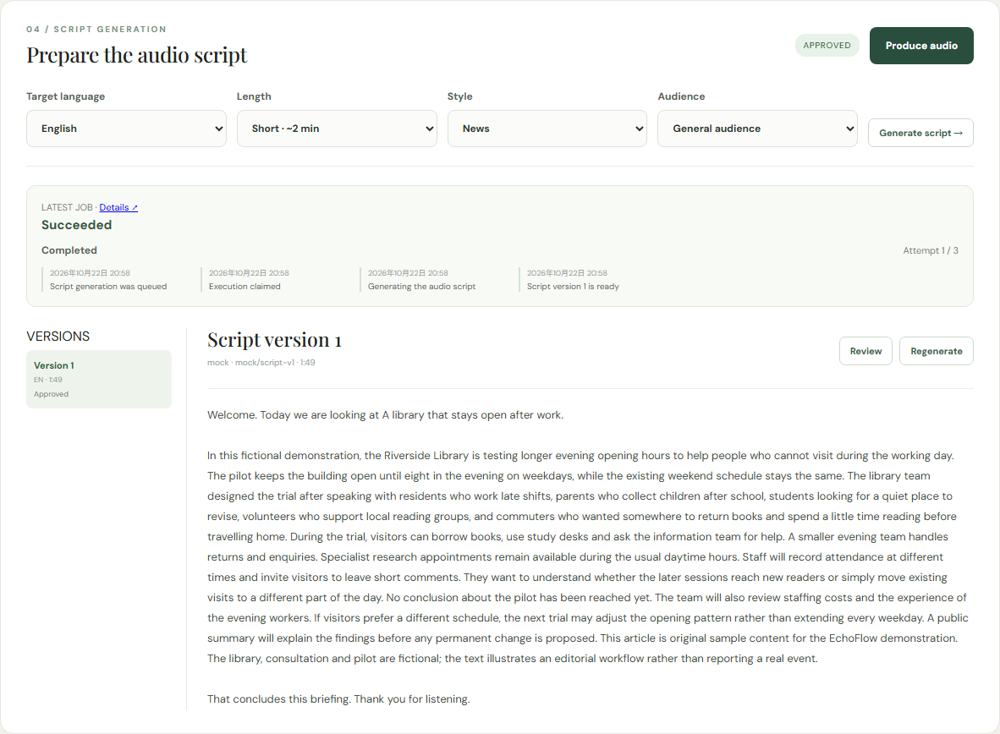
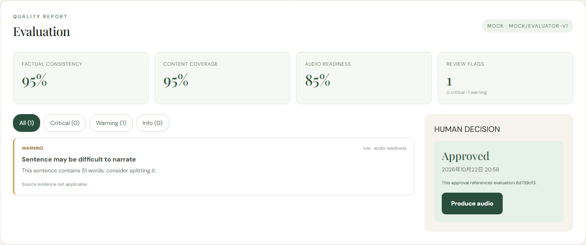
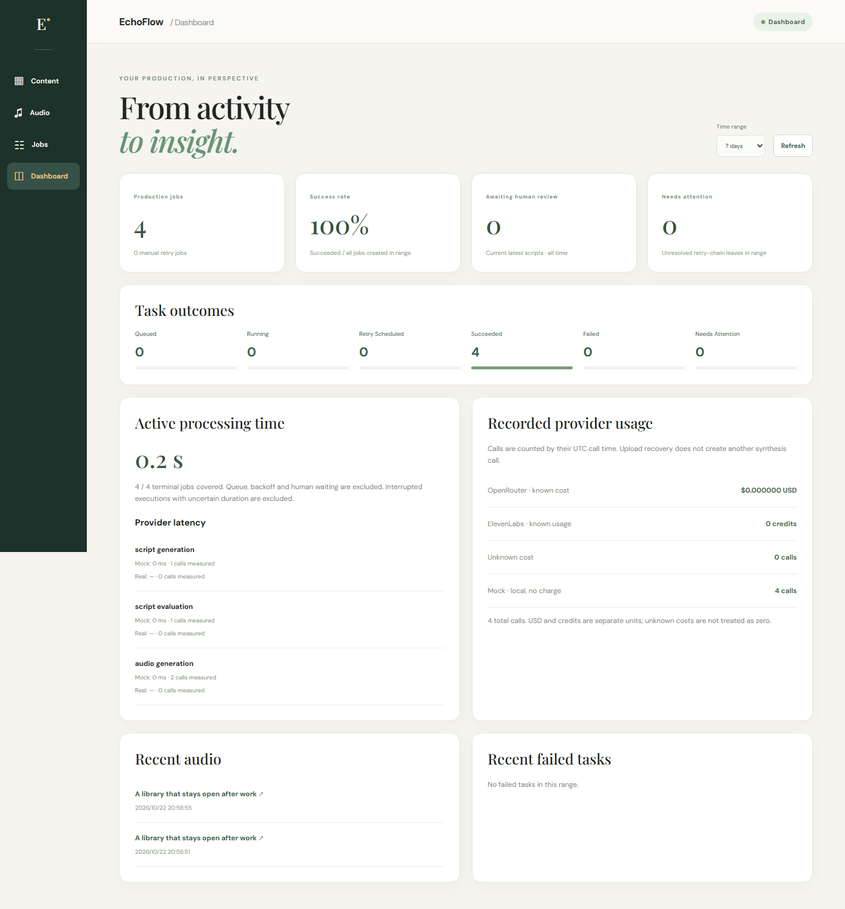
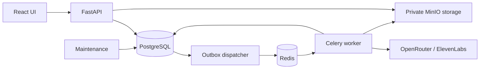

# EchoFlow

Turn English and German articles into scripts you can review, approve and turn into downloadable audio. A personal full-stack project covering the complete workflow, from content import to asynchronous production and failure recovery.

## See it in action



*Real application screenshots with fictional sample content and Mock providers. Mock audio is a two-second test tone; real narration uses ElevenLabs.*

## From article to audio


Choose a language, length, style and audience. Generate a script, explicitly request an evaluation, review the findings and approve that exact version before producing audio. Editing creates a new version that needs its own evaluation and approval.

<details>
<summary>More screenshots: content, review and monitoring</summary>

**Content Studio** — configure generation and keep a version history alongside the source article.



**Script Review** — inspect estimated quality scores and evidence, then make the approval decision yourself.



**Dashboard** — inspect job outcomes, processing time and available provider usage.



</details>

## What you can do

- **Collect articles:** paste text or import public static HTML; duplicate content reuses the saved article.
- **Generate scripts:** select English or German, length, style and audience; retain immutable versions.
- **Review before release:** combine deterministic checks with an LLM Judge, locate evidence and acknowledge critical issues before approval.
- **Produce audio:** select a voice and speed, play recordings and download MP3 files tied to their script and approval.
- **Recover interrupted work:** inspect failed jobs, confirm charge risks and resume checkpointed audio uploads without repeating synthesis.
- **Monitor production:** view job events, execution history, retry chains, latency and available usage across providers.

## How it is built

| Area | Technology |
| --- | --- |
| Frontend | React, TypeScript, Vite, React Router |
| API and persistence | FastAPI, Pydantic, SQLAlchemy, Alembic, PostgreSQL |
| Background work | Celery, Redis, transactional outbox, independent maintenance process |
| AI and speech | OpenRouter, ElevenLabs, deterministic Mock adapters |
| Media | Private MinIO storage, persistent audio checkpoints, HTTP Range playback |
| Verification | Pytest, Vitest, Playwright, GitHub Actions |



Four design choices carry most of the reliability work:

- **Database-owned jobs:** job creation and outbox insertion share a transaction. Delivery is at least once; atomic claims and result constraints handle duplicate messages.
- **Version-specific approval:** editing or re-evaluating invalidates current approval. A new synthesis call must satisfy the current version's review requirements.
- **Recovery that accounts for cost:** uncertain provider outcomes require attention rather than blind retries. Complete audio checkpoints can resume uploads after worker restarts; a crash before checkpoint completion still has an uncertain-charge boundary.
- **Inspectable results:** persist events, execution leases and available provider accounting. Keep USD, credits, unknown cost and Mock calls separate.

## Try it locally

Start Docker Desktop or another Docker engine, then:

```sh
git clone https://github.com/haotian0701/EchoFlow.git
cd EchoFlow
docker compose up --build -d
```

Open **[EchoFlow](http://localhost:5173)** or the **[API reference](http://localhost:8000/docs)**. A fresh checkout uses Mock LLM and TTS providers, so no API keys are needed to explore the complete workflow. Local Node/npm is not required; the frontend toolchain runs in Docker.

The first build also compiles MinIO from its pinned source release and may take longer. Database, queue, media and audio-checkpoint data use named volumes and survive ordinary container restarts.

For real generation and narration, copy `.env.example` to `.env`, select OpenRouter and ElevenLabs and supply your keys. See [provider configuration](docs/operations.md#provider-configuration); existing `.env` settings override the Mock defaults.

## Verification and project scope

[CI](https://github.com/haotian0701/EchoFlow/actions/workflows/ci.yml) runs backend lint/format and unit/integration tests, PostgreSQL migration/concurrency checks, frontend tests and the production build. The optional Mock Compose suite exercises browser workflows and crash recovery without paid provider calls. Commands and test boundaries are in [architecture and development](docs/architecture.md#tests).

This is a **local, single-user MVP** supporting English/German content and static HTML imports. It has no authentication or multi-tenant hosting. Evaluation scores are estimates and never approve scripts automatically.

## Documentation

| Guide | Contents |
| --- | --- |
| [Architecture and development](docs/architecture.md) | Code organization, boundaries, tests and CI |
| [Operations](docs/operations.md) | Provider configuration, persistence, deployment, recovery and API reference |
